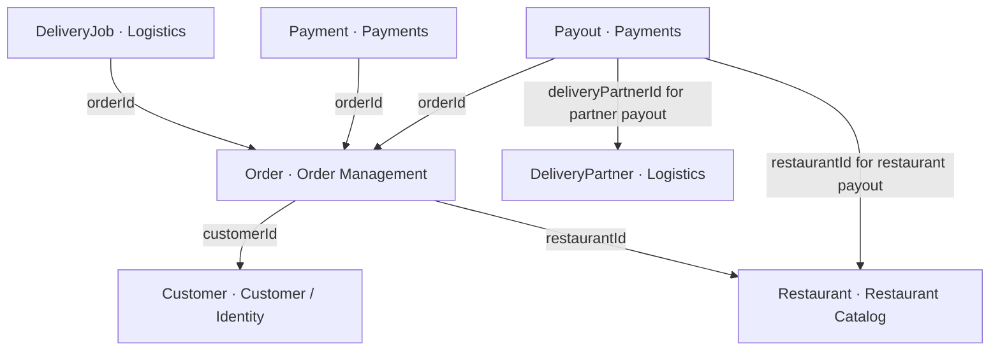
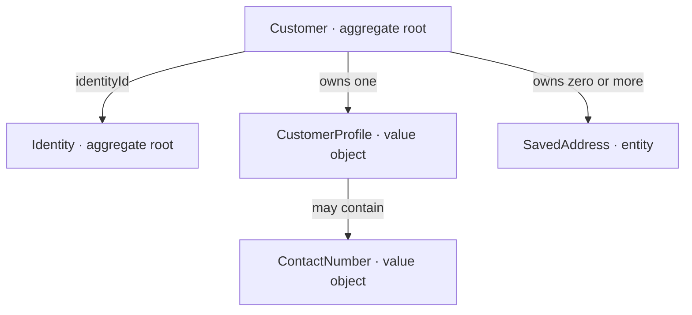
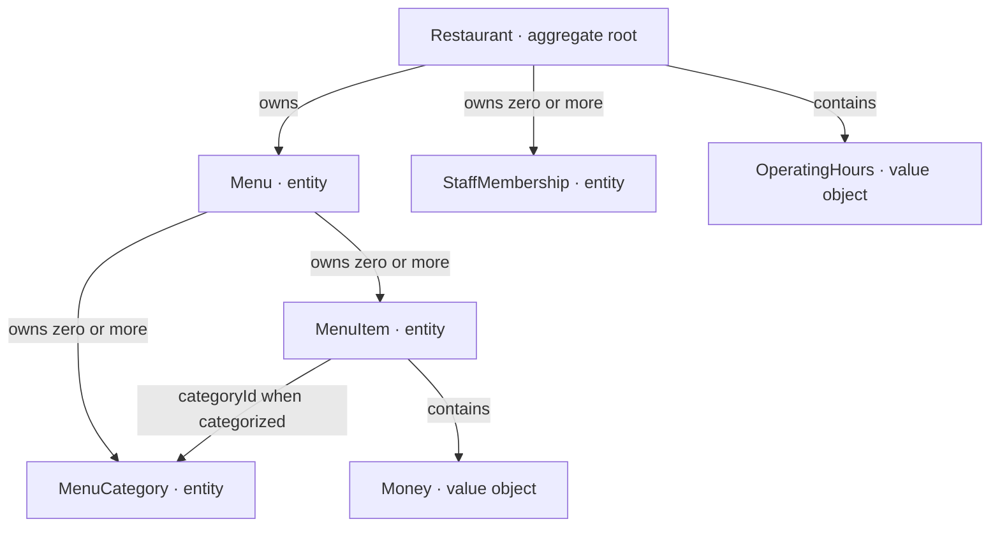
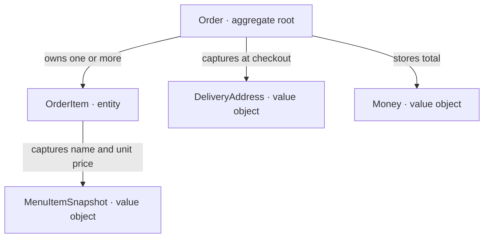
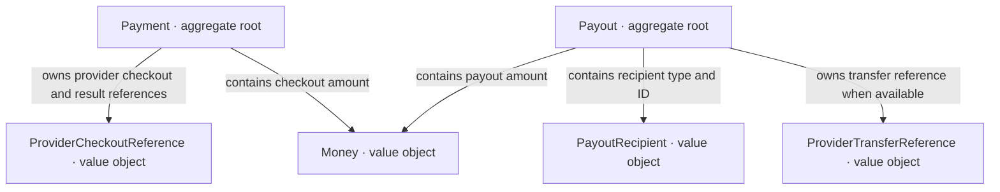
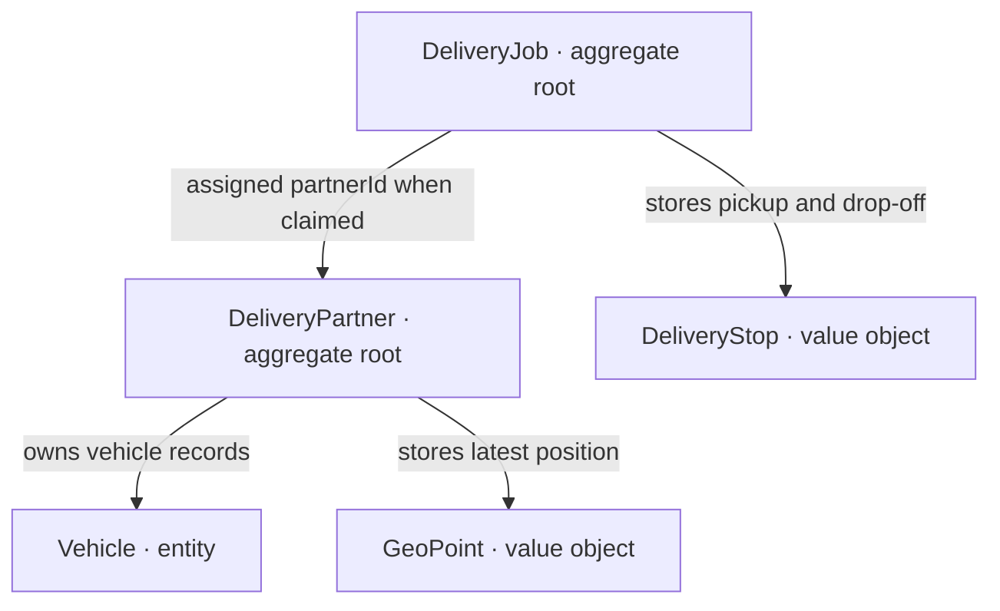

# Buggy DDD entity graph

Proposed domain model for the five backend services in [ADR 002](adr/ADR-002-backend-service-boundaries.md). The [C4 container diagram](c4-diagrams/buggy-container.md) shows how those services communicate. Each aggregate root controls changes to the objects it owns. A reference across aggregates uses an ID. References across services travel through service contracts and use IDs from the owning context, as defined in [ADR 004](adr/ADR-004-backend-databases.md).

## Cross-service references

Read each arrow as “stores this reference to.” A recipient reference identifies either a restaurant or a delivery partner, depending on the payout type.

| Additional reference | Meaning |
| --- | --- |
| `StaffMembership.identityId → Identity` | Catalog uses the shared sign-in identity to determine staff permissions for a restaurant. |
| `DeliveryPartner.identityId → Identity` | Logistics uses the shared sign-in identity to identify an authenticated partner. |
| `OrderItem.menuItemId → MenuItem` | The order keeps the original menu item ID for traceability and captures its name and unit price at checkout. |

## Customer / Identity

`bgy-account-service` · `bgy-account-db`

- `Identity` owns sign-in identity and has a stable `IdentityId` shared by customer, staff, and partner roles. A sign-in identifier must be unique.
- `Customer` owns profile and address changes. A `SavedAddressId` lets a customer edit or remove a particular saved address. The proposed model allows one customer record per identity.

## Restaurant Catalog

`bgy-rest-catalog-service` · `bgy-menu-db`

- `Restaurant` owns staff grants and catalog updates. A staff grant belongs to one restaurant and authorizes operations for that restaurant. The proposed model uses one membership per restaurant and identity, with permissions on the membership.
- Give items and categories stable IDs so staff can rename or edit them while retaining their identity. Under the proposed boundary, a category assigned to an item must belong to the same menu. Restaurant opening hours and item availability support order placement checks.

## Order Management

`bgy-order-service` · `bgy-order-db`

- Placement starts an order in `PendingPayment` with at least one item. Every item has a positive quantity and belongs to the selected restaurant. The checkout address and item prices are captured so later account or catalog edits preserve order history.
- `Order` controls status changes. Payment confirmation advances `PendingPayment` to `Paid`. Preparation closes the order edit window. Logistics progress precedes the `OutForDelivery → Delivered` transition.
- Save `Delivered` and its payout request outbox entry in the same local transaction. The outbox is a persistence mechanism, so the aggregate graph focuses on the business objects.

## Payments

`bgy-payment-service` · `bgy-payment-db`

- `Payment` owns the checkout amount, provider references, and payment status for an order. Deduplicate provider webhook events and send Order Management the confirmed result. A failed checkout leaves the order in `PendingPayment`.
- `Payout` owns the status of one recipient’s transfer independently. The same delivery payout request can be retried and must yield one restaurant payout and one delivery partner payout. Use `(orderId, recipientType)` as the proposed business key for that flow. Reconcile an ambiguous provider result before retrying a transfer.

## Delivery & Logistics

`bgy-logistics-service` · `bgy-delivery-db`

- A job is created for pickup when food is nearly ready. Assignment uses the same eligibility rule for partner claims and automatic matches. The partner must be available and within 3 km of pickup. An atomic claim lets only one partner win a concurrent claim for that job.
- `DeliveryJob` owns assignment and delivery status. `DeliveryPartner` owns availability and the latest position across jobs. Logistics reports progress and completion to Order Management, which owns the order status.
- The proposed model gives vehicle records stable IDs under a partner. If vehicles are managed or reassigned independently, their aggregate boundary should follow that workflow.

## Decisions to confirm before designing the schema

| Question | Why it affects the model |
| --- | --- |
| Can staff or customers make price-changing edits after payment and before preparation? | The rule determines whether edits need a payment adjustment workflow and when order item snapshots become fixed. |
| Do staff manage menus independently, such as scheduling or publishing them separately? | That workflow may justify a separate `Menu` aggregate. The graph currently places menus and memberships under `Restaurant`. |
| Does retrying checkout reuse the same payment record or create separately tracked attempts? | This determines payment cardinality and how provider references and retries are modeled. |
| Can the logistics service replace a cancelled job for the same order? | This determines whether `orderId` identifies one job over its lifetime or only one active job at a time. |
| Does Logistics need to retain location history per job? | A history requirement calls for timestamped observations tied to the job in addition to the partner's latest position. |
