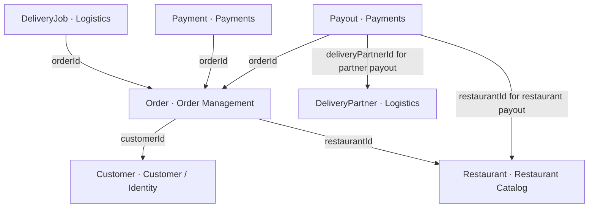
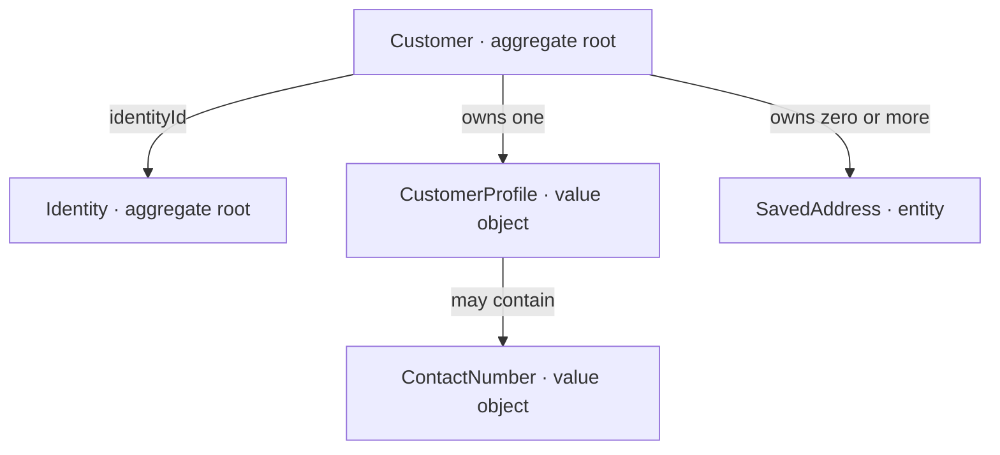
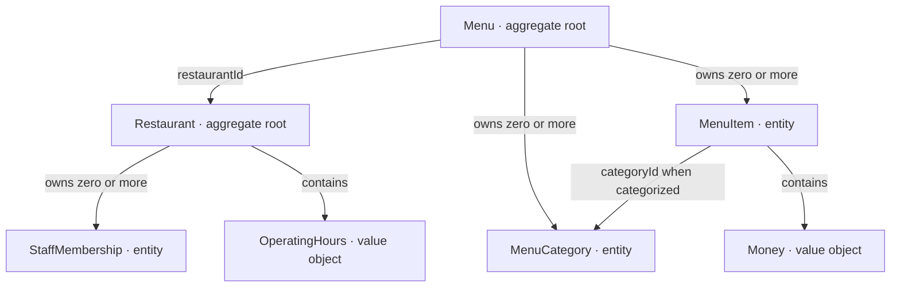
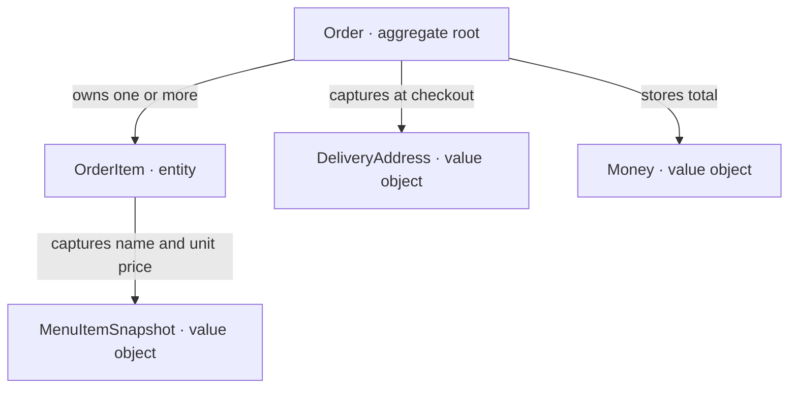
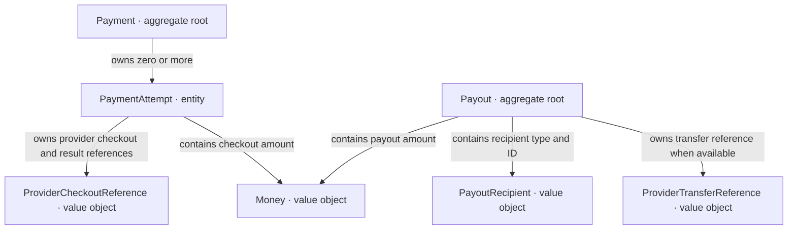
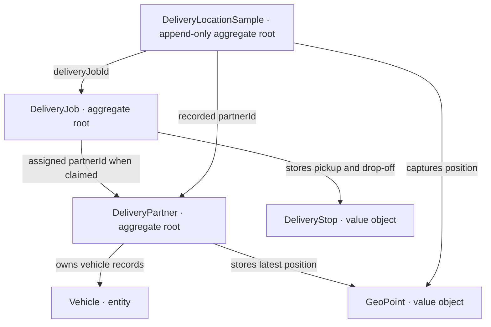

# Buggy DDD entity graph

Proposed domain model for the five backend services in [ADR 002](adr/ADR-002-backend-service-boundaries.md). The [C4 container diagram](c4-diagrams/buggy-container.md) shows how those services communicate. Each aggregate root controls changes to the objects it owns. A reference across aggregates uses an ID. References across services travel through service contracts and use IDs from the owning context, as defined in [ADR 004](adr/ADR-004-backend-databases.md).

## Cross-service references

Read each arrow as “stores this reference to.” A recipient reference identifies either a restaurant or a delivery partner, depending on the payout type.

| Additional reference | Meaning |
| --- | --- |
| `StaffMembership.identityId → Identity` | Catalog uses the shared sign-in identity to determine staff permissions for a restaurant. |
| `DeliveryPartner.identityId → Identity` | Logistics uses the shared sign-in identity to identify an authenticated partner. |
| `OrderItem.menuItemId → MenuItem` | The order keeps the original menu item ID for traceability and captures its name and unit price at checkout. |

## Customer / Identity

`bgy-account-service` · `bgy-account-db`

- `Identity` owns sign-in identity and has a stable `IdentityId` shared by customer, staff, and partner roles. A sign-in identifier must be unique.
- `Customer` owns profile and address changes. A `SavedAddressId` lets a customer edit or remove a particular saved address. The proposed model allows one customer record per identity.

## Restaurant Catalog

`bgy-rest-catalog-service` · `bgy-menu-fb`

- `Restaurant` owns restaurant details, operating hours, and staff grants. A staff grant belongs to one restaurant and authorizes operations for that restaurant. The proposed model uses one membership per restaurant and identity, with permissions on the membership.
- `Menu` has its own lifecycle. Authorized staff can edit, schedule, and publish a menu independently of restaurant updates. A menu owns its items and categories, and a category assigned to an item must belong to that same menu. Restaurant opening hours and the published menu's item availability support order placement checks.

## Order Management

`bgy-order-service` · `bgy-order-db`

- Placement starts an order in `PendingPayment` with at least one item. Every item has a positive quantity and belongs to the selected restaurant. The checkout address and item prices are captured so later account or catalog edits preserve order history.
- `Order` controls status changes. Payment confirmation advances `PendingPayment` to `Paid`. Staff and customers cannot make price-changing edits once payment is confirmed, including before preparation. Preparation closes the edit window for any other changes. Logistics progress precedes the `OutForDelivery → Delivered` transition.
- Save `Delivered` and its payout request outbox entry in the same local transaction. The outbox is a persistence mechanism, so the aggregate graph focuses on the business objects.

## Payments

`bgy-payment-service` · `bgy-payment-db`

- The model uses one `Payment` aggregate per order. Each checkout try gets its own `PaymentAttemptId`, amount, status, and provider references as they become available. Starting a new try creates an attempt. Repeating the same start request with the same idempotency key returns the existing attempt.
- `Payment` owns the overall payment status. Process verified webhooks against the matching attempt and deduplicate by provider event ID. A failed attempt leaves an unpaid order in `PendingPayment`. The first confirmed attempt marks the payment as paid and triggers confirmation to Order Management. A later failure leaves that success in place, and any additional confirmed charge goes to reconciliation.
- `Payout` owns the status of one recipient’s transfer independently. The same delivery payout request can be retried and must yield one restaurant payout and one delivery partner payout. Use `(orderId, recipientType)` as the proposed business key for that flow. Reconcile an ambiguous provider result before retrying a transfer.

## Delivery & Logistics

`bgy-logistics-service` · `bgy-delivery-db`

- A job is created for pickup when food is nearly ready. Assignment uses the same eligibility rule for partner claims and automatic matches. The partner must be available and within 3 km of pickup. An atomic claim lets only one partner win a concurrent claim for that job.
- `DeliveryJob` owns assignment and delivery status. Logistics can create a replacement with a new `DeliveryJobId` after cancellation. An order can have multiple historical jobs and at most one active job. Keep the cancelled job and its tracking history under its original ID.
- `DeliveryPartner` owns availability and the latest position across jobs. Append a timestamped `DeliveryLocationSample` for the assigned partner under the specific job ID. Each sample can be stored independently of the job's state changes, so tracking updates do not grow the `DeliveryJob` aggregate. Logistics reports progress and completion to Order Management, which owns the order status.
- The proposed model gives vehicle records stable IDs under a partner. If vehicles are managed or reassigned independently, their aggregate boundary should follow that workflow.
