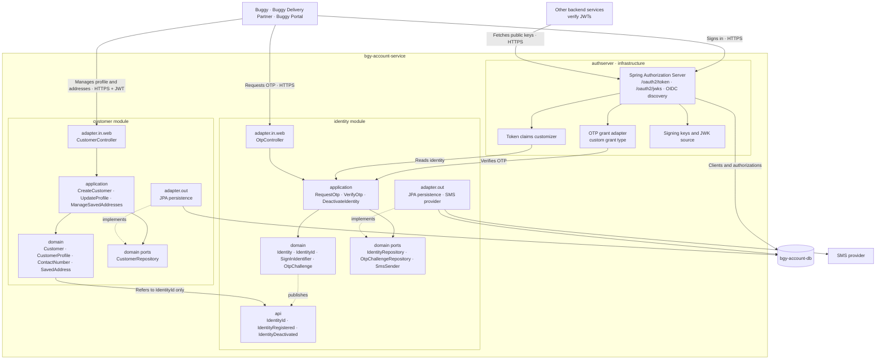

# Buggy — Account Service Package Layout

Proposed · `bgy-account-service` · `bgy-account-db`

**Purpose.** Show how the Customer / Identity context is split into packages so that the identity model, the customer model, and Spring Authorization Server stay separate. The aggregates come from the [DDD entity graph](../buggy-entity-graph.md#customer--identity). The custom identity provider is still an open decision; see item 2 in [open decisions](../open-decisions.md#2-authentication-and-identity).

## Modules and dependencies



Read solid arrows as "calls or depends on". Dashed arrows show an adapter implementing a port, or the domain publishing types and events through `api`.

## Package tree

```text
com.buggy.account
├── AccountApplication.java
│
├── identity                         Generic subdomain: who you are
│   ├── api                          The only package other modules may import
│   │   ├── IdentityId.java          Stable ID shared with every service
│   │   ├── IdentityRegistered.java  Domain event
│   │   └── IdentityDeactivated.java Domain event
│   ├── domain
│   │   ├── Identity.java            Aggregate root
│   │   ├── SignInIdentifier.java    Value object: phone number or email, unique
│   │   ├── IdentityStatus.java      Active, Deactivated
│   │   ├── OtpChallenge.java        Aggregate root: hashed code, expiry, attempts
│   │   ├── IdentityRepository.java      Port
│   │   ├── OtpChallengeRepository.java  Port
│   │   └── SmsSender.java               Port
│   ├── application
│   │   ├── RequestOtp.java          Rate limits, creates challenge, sends SMS
│   │   ├── VerifyOtp.java           Checks code, registers identity on first sign-in
│   │   └── DeactivateIdentity.java
│   └── adapter
│       ├── in/web/OtpController.java        POST /auth/otp/request
│       └── out
│           ├── persistence/                 JPA entities and repository adapters
│           └── sms/                         SMS provider client
│
├── customer                         Supporting subdomain: profile and addresses
│   ├── domain
│   │   ├── Customer.java            Aggregate root, holds an IdentityId
│   │   ├── CustomerId.java
│   │   ├── CustomerProfile.java     Value object
│   │   ├── ContactNumber.java       Value object
│   │   ├── SavedAddress.java        Entity inside Customer
│   │   ├── SavedAddressId.java
│   │   └── CustomerRepository.java  Port
│   ├── application
│   │   ├── CreateCustomer.java
│   │   ├── UpdateProfile.java
│   │   └── ManageSavedAddresses.java
│   └── adapter
│       ├── in/web/CustomerController.java   /v1/customers/me, /v1/customers/me/addresses
│       └── out/persistence/
│
├── authserver                       Infrastructure: Spring Authorization Server
│   ├── AuthorizationServerConfiguration.java  SAS filter chain and endpoints
│   ├── RegisteredClientsConfiguration.java    Portal, apps, service clients
│   ├── SigningKeyConfiguration.java           JWK source, keys from the secret store
│   ├── OtpGrantAuthenticationConverter.java
│   ├── OtpGrantAuthenticationProvider.java    Calls identity.application.VerifyOtp
│   └── TokenClaimsCustomizer.java
│
└── config
    └── SecurityConfiguration.java   Resource-server chain for /v1/** and /auth/**
```

## Dependency rules

1. **Domain packages depend on nothing else in the service.** `identity.domain` and `customer.domain` use plain Java only. Spring, JPA, and SAS types stay out.
2. **Adapters depend inward.** `adapter.in` calls `application`. `adapter.out` implements the ports declared in `domain`.
3. **`customer` sees only `identity.api`.** A `Customer` stores an `IdentityId` and never loads an `Identity`. This keeps the generic identity subdomain replaceable.
4. **`authserver` is an adapter around `identity`.** It calls `identity.application` use cases and never touches `identity.domain` or the identity tables directly. SAS tables (`oauth2_registered_client`, `oauth2_authorization`) belong to `authserver` alone.
5. **Each module owns its tables.** The `identity`, `customer`, and `authserver` tables share `bgy-account-db`, but no module queries another module's tables.

An ArchUnit test in the service can enforce these rules in the Jenkins build.

## Key flows

**Customer app phone sign-in**
1. The app calls `POST /auth/otp/request`. `RequestOtp` applies rate limits, saves an `OtpChallenge`, and sends the code through `SmsSender`.
2. The app calls `POST /oauth2/token` with the custom OTP grant. `OtpGrantAuthenticationProvider` calls `VerifyOtp`.
3. On the first successful sign-in, `VerifyOtp` creates the `Identity` and publishes `IdentityRegistered`.
4. SAS issues the access and refresh tokens. The `sub` claim is the `IdentityId`.

**Creating the customer record**
- A staff member or delivery partner has an `Identity` but no `Customer`. The customer app therefore calls `POST /v1/customers/me` after the first sign-in, and `CreateCustomer` links the new `Customer` to the caller's `IdentityId`.

## Open questions

| Question | Why it matters |
| --- | --- |
| Which claims go in the token besides `sub`? | Staff memberships live in Catalog and partner records in Logistics. If tokens carry only the `IdentityId`, each service looks up its own permissions, which matches the container diagram. Adding roles to tokens would make Account depend on other contexts. |
| How do `IdentityRegistered` and `IdentityDeactivated` reach other services? | In-process Spring events cover the `customer` module. Other services need the outcome of item 3 in [open decisions](../open-decisions.md#3-communication-between-services). |
| How do restaurant staff sign in to Buggy Portal? | Phone OTP, or email and password through a hosted sign-in page. A password adds a `PasswordCredential` to `Identity` and a login page in `authserver`. |
| Should "account" be renamed to match "Customer / Identity"? | DDD's ubiquitous language asks for one name for the context across code, docs, and APIs. |
