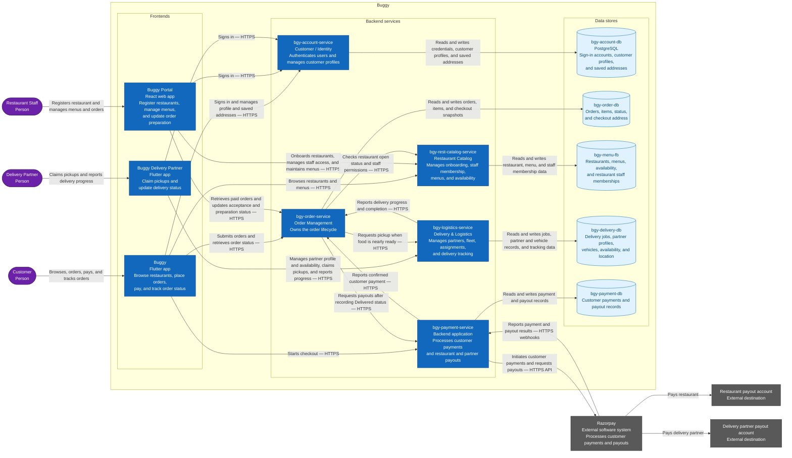

# Buggy — Container Diagram

**Purpose.** Show which applications and data stores make up Buggy and how they work together. In C4, a container is an application or a data store.

Follow `bgy-order-service` to see where order status is stored. It writes to `bgy-order-db` and receives payment and delivery updates from the services that own those workflows. The restaurant portal reads paid orders from the order service, and the delivery app reads available pickups from the logistics service.

## Bounded contexts and data ownership

Each context owns its model and writes to its own data store. This design maps each context to an existing backend service. Customer / Identity issues tokens with a stable identity ID. A customer, a restaurant staff membership, and a delivery partner each have their own domain identifier and can link to the same sign-in identity. Each service validates the identity and applies its own domain permissions.

| Context | System of record | Model and responsibilities |
| --- | --- | --- |
| Restaurant Catalog | `bgy-menu-fb` | Owns the `Restaurant` aggregate and models menus, items, categories, address, operating hours, prices, and dietary tags. Owns staff memberships linking a sign-in identity to a restaurant and its staff permissions. |
| Order Management | `bgy-order-db` | Owns the `Order` aggregate, its `OrderItem` entities, status, delivery address, and total. At placement, the service checks Catalog for restaurant open status. The order enforces the edit cutoff when preparation starts. |
| Delivery & Logistics | `bgy-delivery-db` | Owns the `DeliveryJob` aggregate, tracking, delivery status, and ETA. Models `DeliveryPartner` as a separate aggregate because availability, location, and vehicle data persist across jobs. The assignment operation verifies that the partner is available and within 3 km of the pickup before assigning the job. |
| Customer / Identity | `bgy-account-db` | Owns authentication for all three roles and the `Customer` aggregate with `CustomerProfile`, `SavedAddress`, and `ContactNumber`. |
| Payments | `bgy-payment-db` | Owns payment and payout records, provider references, and transaction status. Razorpay processes payments and payouts. |

At checkout, the app submits the selected address as part of the order. Order Management stores its own `DeliveryAddress` snapshot so later edits to a saved address leave the order history intact. Order Management resolves staff access through Catalog using the authenticated identity and the restaurant ID on the order. Logistics owns assignment for both a partner claim and an automatic match and checks eligibility at assignment time.

Next, open the [Order Service Component Diagram](buggy-order-service-components.md) to see how the order service handles those updates.
