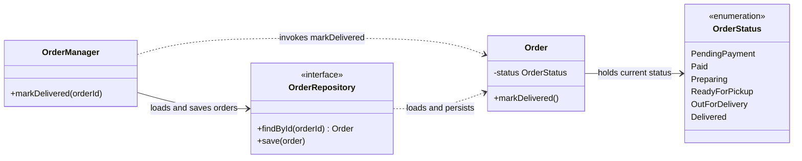

# Buggy — Order Manager Code Diagram

C4 Level 4 · Proposed object-oriented design for marking an order delivered.

**Purpose.** Show which code elements load an order, validate the delivery status change, and save it.

1. `OrderManager.markDelivered(orderId)` uses `OrderRepository.findById(orderId)` to load the order. If the order is missing, the operation ends with an error.
2. `Order.markDelivered()` checks that the order is `OutForDelivery` and changes it to `Delivered`. An invalid transition ends the operation before any save.
3. `OrderManager` calls `OrderRepository.save(order)` to persist the new status. At Level 3, a successful save precedes the payout request through the Payment Client.

This proposal assumes `OutForDelivery` is recorded by a prior logistics update. The repository interface represents the dependency on the Level 3 Order Repository component.
