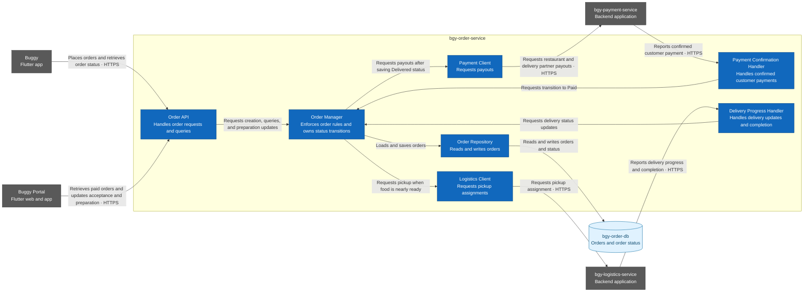

# Buggy — Order Service Component Diagram

C4 Level 3 · `bgy-order-service`

**Purpose.** Show how the order service handles requests, applies order rules, saves order status, and communicates with payment and logistics.

## Flow checks

- **Place an order.** Buggy submits the order through the Order API. The Order Manager validates it and uses the Order Repository to save it in `bgy-order-db` with status Pending Payment.
- **Confirm payment.** The payment service reports a confirmed customer payment to the Payment Confirmation Handler. The Order Manager validates the transition and saves Paid through the repository. Buggy Portal can then retrieve the order through the Order API.
- **Assign pickup and complete delivery.** When the portal reports that food is nearly ready, the Order Manager requests a pickup through the Logistics Client. The logistics service reports progress and completion to the Delivery Progress Handler. The Order Manager saves Delivered through the repository, then requests both payouts through the Payment Client.

The Order Manager owns all order status transitions. Pending Payment is the assumed initial status. The Delivery Progress Handler covers both in-progress updates and final delivery to match the Level 2 logistics relationship.
