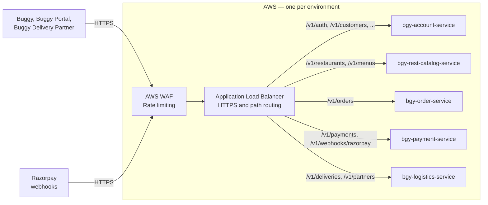

# API gateway

- **Status** — In discussion ([open decision 10](../open-decisions.md#10-app-entry-point-and-cors))
- **Last updated** — 2026-11-25

This page describes the single entry point the three apps and Razorpay webhooks use to reach the five backend services. The proposal is a **thin gateway**: it handles HTTPS, routing, and rate limiting, and leaves authentication and business rules to the services.

## The proposal

Use an **AWS Application Load Balancer (ALB) with AWS WAF** as the gateway in AWS, and a **Caddy** reverse proxy in Docker Compose for local development. Both are configuration, not code, so there is no gateway service to build, test, or deploy.

## What the gateway does and does not do

| Job | Where it happens |
| --- | --- |
| HTTPS | The ALB, with a free certificate from AWS Certificate Manager |
| Routing by path | ALB listener rules, one per path prefix, each forwarding to a service's target group |
| Rate limiting | AWS WAF rate-based rules attached to the ALB |
| Health checks | Each target group calls the service's `/actuator/health/readiness` |
| WebSockets | Supported by the ALB without extra setup ([open decision 8](../open-decisions.md#8-real-time-updates-and-tracking)) |
| Token validation | **Each service**, not the gateway. A request that reaches a service by mistake still cannot get in. |
| Service-to-service calls | **Not through the gateway.** Services call each other directly inside the VPC. |

## Routing table

This is a first draft based on the ownership in [ADR 002](../adr/ADR-002-backend-service-boundaries.md). The final paths depend on [open decision 4](../open-decisions.md#4-api-conventions) (API conventions).

| Path | Service | Local port |
| --- | --- | --- |
| `/v1/auth/*`, `/v1/customers/*`, `/v1/addresses/*` | `bgy-account-service` | 8081 |
| `/v1/restaurants/*`, `/v1/menus/*` | `bgy-rest-catalog-service` | 8082 |
| `/v1/orders/*` | `bgy-order-service` | 8083 |
| `/v1/payments/*`, `/v1/webhooks/razorpay` | `bgy-payment-service` | 8084 |
| `/v1/deliveries/*`, `/v1/partners/*` | `bgy-logistics-service` | 8085 |
| Any other path | The gateway returns `404` | — |

The default `404` keeps `/actuator/*`, `/openapi/*`, and any path not listed unreachable from the internet. The ALB still reaches `/actuator/health/readiness` for health checks, because those calls go straight to the target and do not pass through the listener rules.

## Rate limiting

AWS WAF counts requests per IP address over a time window and blocks an address that goes over the limit. Proposed starting rules:

| Rule | Paths | Limit per IP address |
| --- | --- | --- |
| Sign-in | `/v1/auth/*` | Low, for example 20 requests a minute |
| General | Everything else | Higher, for example 1,000 requests in 5 minutes |
| Webhooks | `/v1/webhooks/razorpay` | No rate rule. The payment service verifies the Razorpay signature instead. |

Tune the limits after watching real traffic in the WAF logs.

## CORS

Only Buggy Portal needs CORS, because it is the only app that runs in a browser. The Flutter apps are native and do not send CORS checks.

**Proposed: avoid CORS by using one origin.** Serve Buggy Portal from the same domain as the API, for example `/` for the Portal and `/v1/*` for the services. The browser then sees a single origin and sends no CORS checks.

If the Portal must have its own domain instead, every service needs the same CORS settings, either copied into each service or provided by a shared library ([open decision 5](../open-decisions.md#5-shared-code-across-services)).

## How to build it

### In AWS

All of these are written in Terraform (see [AWS hosting](aws-hosting.md#rules)), so the gateway is created and destroyed with the rest of the environment.

1. **Domain** — HTTPS needs a domain you control. AWS Certificate Manager cannot issue a certificate for the ALB's own `*.elb.amazonaws.com` name, and Razorpay webhooks require HTTPS. Use one subdomain per environment, for example `dev.api.<domain>` and `staging.api.<domain>`.
2. **Certificate** — request one in AWS Certificate Manager and validate it through DNS.
3. **Load balancer** — create the ALB in the public subnets of the environment's VPC.
4. **Listeners** — one on port 80 that redirects to HTTPS, and one on port 443 with the certificate and a default action that returns `404`.
5. **Target groups** — one per service, using the `ip` target type that Fargate needs, with the readiness health check.
6. **Listener rules** — one path rule per row of the routing table.
7. **WAF** — a web ACL with the rate rules above, associated with the ALB.
8. **Security groups** — the ALB accepts ports 80 and 443 from the internet. Each service accepts traffic only from the ALB's security group, plus from the other services that call it.
9. **ECS** — each ECS service is linked to its target group, so new tasks register automatically during a deployment and old ones are drained.
10. **DNS** — point the environment's subdomain at the ALB.

### Locally

Add a `docker-compose.yml` with a Caddy container on `localhost:8080` and the same path rules, forwarding to ports 8081–8085. The apps then use one base URL in every environment, and only the host name changes:

| Environment | API base URL |
| --- | --- |
| local | `http://localhost:8080` |
| dev | `https://dev.api.<domain>` |
| staging | `https://staging.api.<domain>` |

Keep the Caddy routes and the Terraform listener rules in step. A new path prefix needs a change in both.

## Alternative considered: Spring Cloud Gateway

A sixth Spring Boot service running Spring Cloud Gateway would behave the same locally and in AWS, and could handle CORS and rate limiting in one place. It is not proposed for the first release because:

- It is another service to build, test, deploy, and keep updated.
- It costs another Fargate task in each environment.
- Its rate limiting needs Redis, which means Amazon ElastiCache and more cost.
- It still needs an ALB in front of it for HTTPS.

Reconsider it if the apps need request rewriting, or responses that combine several services into one.

Amazon API Gateway, the AWS product, is also not proposed. It has more features than Buggy needs, and the ALB is still the simpler fit for containers on ECS.

## Still to decide

- Agree this proposal, then record it in an ADR together with [open decision 10](../open-decisions.md#10-app-entry-point-and-cors).
- The domain name, and who registers it.
- The final route paths, after [open decision 4](../open-decisions.md#4-api-conventions).
- Whether Buggy Portal is served from the same origin as the API, which decides whether CORS is needed.
- The starting rate limits.
