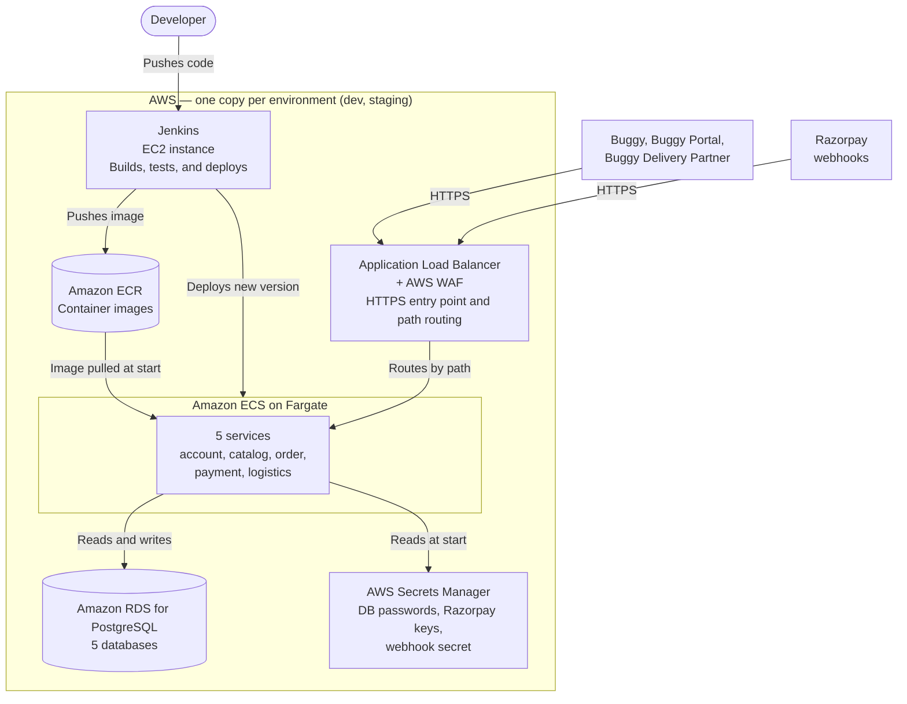

# AWS hosting

- **Status** — In discussion ([open decision 9](../open-decisions.md#9-hosting-and-delivery-pipeline))
- **Last updated** — 2026-11-25

This page describes where Buggy runs on AWS and how new code gets there. Today the five services run only on a developer's machine on ports 8081–8085. To serve the three apps, they need servers on the internet and a reliable way to deploy new versions.

## What is decided and what is proposed

| Area | Decided | Proposed, not yet agreed |
| --- | --- | --- |
| Cloud | AWS | — |
| Runtime for the five services | — | Amazon ECS on Fargate |
| Container images | One Dockerfile per service | Images stored in Amazon ECR |
| CI | Jenkins ([ADR 009](../adr/ADR-009-ci-pipeline.md)) | Jenkins controller on one EC2 instance |
| CD | — | Jenkins deploys to dev on every merge to `main`, and to staging after manual approval |
| Environments | local, dev, staging | — |
| Secrets | Kept in AWS | AWS Secrets Manager |
| Database | Hosted in AWS | Amazon RDS for PostgreSQL, one instance per environment holding the five databases |
| Entry point for the apps | — | Application Load Balancer, with AWS WAF for rate limiting ([open decision 10](../open-decisions.md#10-app-entry-point-and-cors)) |

When the proposed column is agreed, record it in an ADR (ADR 010) and mark open decision 9 as decided.

## How the pieces fit together

## From a push to a running service

1. A developer pushes a branch. Jenkins builds and tests only the parts that changed, as [ADR 009](../adr/ADR-009-ci-pipeline.md) describes.
2. After the pull request merges into `main`, Jenkins builds a Docker image for each changed service from its Dockerfile and pushes it to ECR. Each image is tagged with its Git commit ID.
3. Jenkins tells ECS to run the new image in **dev**. ECS starts the new containers, waits until `/actuator/health/readiness` passes, then stops the old ones.
4. To release to **staging**, someone approves the step in Jenkins, and the same image is deployed there. The image is not rebuilt, so staging runs exactly what was tested in dev.

## The AWS services in plain words

### EC2 — a virtual computer you rent

EC2 (Elastic Compute Cloud) gives you a virtual server. You choose its size and operating system, log in, install what you need, and pay by the hour while it runs. You are responsible for operating-system updates, security patches, and restarting it when something breaks.

It is like renting an empty apartment: you get the space and the keys, and the furnishing, cleaning, and repairs are your job.

**Buggy uses EC2 for Jenkins.** Jenkins is one long-running tool, not a service deployed many times. It needs a disk that keeps its job history, plugins, and settings, and Docker installed to build images. One small EC2 instance with an attached EBS disk fits that well.

### ECS on Fargate — where the services run

ECS (Elastic Container Service) runs containers. With the **Fargate** launch type, AWS supplies and maintains the servers underneath, so you never see or patch them. You tell ECS which image to run and how many copies, and it starts them, restarts them if they crash, and replaces them during a deployment.

It is like staying in a hotel room: you use the room, and the hotel takes care of the building.

| | EC2 | ECS on Fargate |
| --- | --- | --- |
| What you get | A whole virtual server | A place to run containers, with no server to manage |
| Who patches the operating system | You | AWS |
| Who restarts a crashed process | You set it up | AWS |
| How to scale | Add more servers | Change the number of running copies |

The alternative is **EKS**, AWS's managed Kubernetes. It offers more control but has much more to set up and operate, so it is not proposed for the first release.

### ECR — where the images are stored

ECR (Elastic Container Registry) stores the Docker images Jenkins builds. ECS pulls images from it when it starts a container.

### RDS for PostgreSQL — where the databases run

RDS (Relational Database Service) runs PostgreSQL for you, including backups, minor version updates, and restarts. It uses servers underneath, but you never log in to them.

[ADR 004](../adr/ADR-004-backend-databases.md) gives each service its own logical database. In dev and staging, one RDS instance per environment holds all five databases (`bgy-account-db`, `bgy-menu-db`, `bgy-order-db`, `bgy-payment-db`, `bgy-delivery-db`). Each service has its own database user and can reach only its own database. Aurora PostgreSQL is an alternative with more features and a higher cost than Buggy needs for now.

### Secrets Manager — where passwords live

Secrets Manager stores database passwords, Razorpay Test Mode keys, and the Razorpay webhook secret. ECS passes them to each service as environment variables when the container starts, so they never appear in Git or in the image. Secrets Manager can also rotate RDS passwords automatically.

Systems Manager Parameter Store is a cheaper, simpler alternative without automatic rotation.

[ADR 009](../adr/ADR-009-ci-pipeline.md) keeps the secrets **Jenkins** needs during builds in the Jenkins credentials store. Secrets Manager holds the secrets the **running services** need.

### Application Load Balancer and WAF — the entry point

The Application Load Balancer (ALB) is the single public HTTPS address for the three apps and for Razorpay webhooks. It routes each request by path, for example `/v1/orders/*` to the order service, and supports WebSockets. Its HTTPS certificate comes free from AWS Certificate Manager.

The ALB has no rate limiting of its own. **AWS WAF** (Web Application Firewall), attached to the ALB, adds rate-based rules, such as limiting sign-in attempts per IP address.

Note the naming: AWS also has a product called **Amazon API Gateway**. It has more features than Buggy needs now. The thin gateway proposed for [open decision 10](../open-decisions.md#10-app-entry-point-and-cors) is the ALB. [API gateway](api-gateway.md) describes its routing, rate limiting, and how to build it.

## Cost and shutting down

AWS charges by the hour for most of this setup, so the environments run only while they are needed and are removed afterwards. Approximate monthly prices, if left running, are below. They are estimates; check them in the [AWS Pricing Calculator](https://calculator.aws/) for the chosen region.

| Item | If left running, per environment per month |
| --- | --- |
| ECS on Fargate, 5 services at 0.25 vCPU and 1 GB each | ~$53 |
| Application Load Balancer | ~$18 |
| Public IPv4 addresses, $3.65 each | ~$15–25 |
| RDS for PostgreSQL, `db.t4g.micro` | $0–15, depending on Free Tier eligibility |
| AWS WAF | ~$7 |
| Secrets Manager, about 7 secrets | ~$3 |
| ECR and CloudWatch Logs | ~$2–4 |
| Jenkins on EC2, `t3.medium` (shared by all environments) | ~$33 |

### Stopping is not enough

Stopping some resources still leaves others charging. Remove the environment completely when it is not needed.

| Resource | Stop | What still costs money |
| --- | --- | --- |
| ECS services | Set the desired count to 0 | Nothing for the tasks |
| RDS | Stop the instance | Storage and backups. AWS **restarts a stopped instance after 7 days**. |
| Application Load Balancer | Cannot be stopped | Charged every hour it exists. Delete it. |
| Public IPv4 addresses | — | Charged while allocated, even when idle. Release them. |
| Secrets Manager | — | Charged per secret per month. Delete the secrets. |
| NAT gateway, if used | Cannot be stopped | ~$32 a month plus data. Delete it. |
| EC2 (Jenkins) | Stop the instance | The EBS disk. |

### Rules

- Define every AWS resource as code, for example with Terraform or AWS CDK, so an environment can be created and destroyed with one command each and nothing is left behind.
- Run the services in public subnets, with security groups that accept traffic only from the load balancer, so no NAT gateway is needed.
- Before creating anything, set an **AWS Budget** alert, for example at $20 a month.
- After destroying an environment, check **Billing → Bills** and **Cost Explorer** the next day to confirm nothing is still charging.

## Still to decide

- Agree the proposed column in the table at the top, then write ADR 010.
- **AWS region** — for example, `ap-south-1` (Mumbai), close to users in India and to Razorpay.
- **Network layout** — the VPC, which parts sit in public and private subnets, and the security groups that control which parts can talk to each other. Only the ALB should be reachable from the internet.
- **Permissions** — the IAM roles that let Jenkins push to ECR and deploy to ECS, and that let each service read only its own secrets.
- **iOS builds** — [ADR 009](../adr/ADR-009-ci-pipeline.md) needs a macOS agent. EC2 Mac instances exist, but they must be rented for at least 24 hours at a time and cost much more than Linux instances.
- **Observability** — with AWS, CloudWatch and AWS X-Ray become the natural defaults for [open decision 11](../open-decisions.md#11-observability-backend).
- **Infrastructure as code** — Terraform or AWS CDK, to create and destroy each environment.
