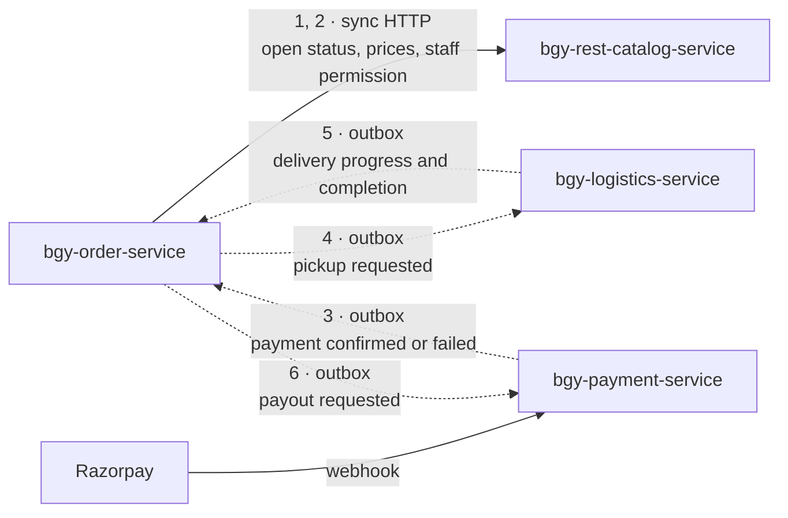

# Service communication and caching

- **Status** — In discussion ([open decision 3](open-decisions.md#3-communication-between-services), [open decision 17](open-decisions.md#17-caching))
- **Last updated** — 2026-11-25

This page proposes how the five backend services call each other, how messages survive failures, and what Buggy caches. Nothing here is decided yet. When the team agrees, record the result in ADRs and tick the open decisions.

## Where things stand

- The [container diagram](c4-diagrams/buggy-container.md) shows every call between services as synchronous HTTPS.
- [ADR 001](adr/ADR-001-backend-architecture.md) and [ADR 004](adr/ADR-004-backend-databases.md) already require a **durable outbox** for the payout request: Order Management saves `Delivered` and the payout request in the same transaction, the request is retried, and Payments handles repeats idempotently.
- No service has an HTTP client, a message broker, or a cache yet. Every service runs Spring Boot 4.1.2 with PostgreSQL and OpenTelemetry tracing.
- [AWS hosting](devops/aws-hosting.md) proposes Amazon ECS on Fargate, and the [API gateway](devops/api-gateway.md) page says services call each other directly inside the VPC, not through the gateway.

## The proposal in one paragraph

Use **synchronous HTTP only when the caller needs an answer before it can reply**. Send every **state change that another service must eventually act on** through a **transactional outbox** in the sender's own database. A relay in the sender delivers each message over HTTP, with retries, to an internal endpoint on the receiver, and the receiver records each message ID so a repeat has no effect. This needs no message broker, so there is no new infrastructure to run locally or in AWS. For caching, start with **HTTP caching on catalog reads** and a **short in-process cache** for the order service's checks against the catalog. Add a shared cache (Redis) only when measurements show it is needed.

## Communication

### Every interaction between services

| # | From → To | What | Proposed style | Why |
| --- | --- | --- | --- | --- |
| 1 | Order → Catalog | Check that the restaurant is open and the prices are current at order placement | Sync HTTP | The order cannot be accepted without the answer. |
| 2 | Order → Catalog | Check a staff member's permission for a restaurant's orders | Sync HTTP | Needed to authorize the portal request. |
| 3 | Payment → Order | Customer payment confirmed (`Paid`) or failed | Async (outbox) | The Razorpay webhook must be acknowledged quickly and must not be lost if the order service is down. |
| 4 | Order → Logistics | Request pickup when food is nearly ready | Async (outbox) | Staff should not see an error because Logistics is briefly unavailable. |
| 5 | Logistics → Order | Delivery progress and completion | Async (outbox) | Completion triggers payouts, so it must not be lost. |
| 6 | Order → Payment | Request restaurant and partner payouts after `Delivered` | Async (outbox) | Already required by ADR 001 and ADR 004. |

The three apps keep calling the services synchronously over HTTPS through the gateway. Real-time updates to the apps are a separate decision ([open decision 8](open-decisions.md#8-real-time-updates-and-tracking)).

Solid arrows are synchronous calls. Dashed arrows are outbox messages.

### Synchronous calls

- Use Spring's `RestClient` with an HTTP service interface for each target service, generated from or checked against the target's OpenAPI document ([open decision 4](open-decisions.md#4-api-conventions)).
- **Timeouts** — 1 second to connect and 2 seconds to read, set explicitly on every client. Never use the defaults, which wait indefinitely.
- **Retries** — retry only reads (`GET`), once, after a short pause. Never retry a write synchronously; send writes through the outbox instead.
- **When the target is down** — fail fast with a clear `503` to the app. Consider a circuit breaker (Resilience4j) once real traffic shows repeated slow failures; it is not proposed for the first release.
- **Addresses** — read each target's base URL from configuration, such as `BGY_CATALOG_URL`. Locally it is `http://localhost:8082`. In AWS, use ECS Service Connect names, such as `http://bgy-rest-catalog-service:8082`.
- **Authentication** — every call carries a token. Which token (the user's, or the calling service's own from OAuth client credentials) is part of [open decision 2](open-decisions.md#2-authentication-and-identity).
- **Tracing** — the existing OpenTelemetry setup passes the trace ID on outgoing `RestClient` calls, so a request can be followed across services.

### Outbox messages

**Sending.** When a service changes its own state and another service must hear about it, it inserts a row into its own `outbox_message` table in the same database transaction. Either both are saved or neither is.

| Column | Purpose |
| --- | --- |
| `id` | UUID. Sent as the `Idempotency-Key` header, so the receiver can spot repeats. |
| `type` | For example `PaymentConfirmed`, `PickupRequested`, `DeliveryCompleted`, `PayoutRequested`. |
| `aggregate_id` | The order ID. Messages for the same order are delivered in the order they were created. |
| `payload` | JSON body of the message. |
| `created_at`, `attempts`, `next_attempt_at`, `status`, `last_error` | Delivery bookkeeping. `status` is `PENDING`, `SENT`, or `FAILED`. |

**Delivering.** A scheduled relay inside the sending service picks up due `PENDING` rows with `SELECT … FOR UPDATE SKIP LOCKED`, so several replicas can run the relay without sending the same row twice at the same time. It sends each row as an HTTP `POST` to an internal endpoint on the receiver, such as `POST /internal/v1/order-events`. A `2xx` response marks the row `SENT`. Internal endpoints are not routed by the gateway.

**Retrying.** On a failure or timeout, wait and try again: 5 seconds, then doubling up to 10 minutes between attempts, for up to 24 hours. After that, mark the row `FAILED`, log it, and raise an alert. ADR 001 asks to track payout backlog and failed order transitions, so alert on the count of `FAILED` rows and on `PENDING` rows older than 5 minutes ([open decision 11](open-decisions.md#11-observability-backend)).

**Receiving.** The receiver saves the `Idempotency-Key` in a `processed_message` table in the same transaction as the change the message causes. If the key is already there, it returns `200` and does nothing. Keep processed keys for 30 days. The receiver also checks the order state machine ([open decision 6](open-decisions.md#6-order-state-machine)), so a late or out-of-order message that would move an order backwards is accepted and ignored.

**Cleanup.** Delete `SENT` rows after 7 days.

### Alternatives considered for messaging

| Option | Tradeoff |
| --- | --- |
| Outbox with an HTTP relay (proposed) | No new infrastructure. Works the same locally and in AWS, and stays inside each service's own database. Each sender owns its retry loop, and each message goes to exactly one receiver. |
| Outbox with Amazon SQS and SNS | Retries, dead-letter queues, and delivery to several receivers come built in. Adds AWS resources per environment, LocalStack or real AWS for local development, and still needs the outbox so the message is never lost before it reaches the queue. |
| Outbox with Kafka or RabbitMQ | Strong ordering and replay (Kafka) or flexible routing (RabbitMQ). Much more to run and learn than four point-to-point messages need. |
| Synchronous HTTP everywhere | Simplest to write. A short outage of one service loses or blocks payments, pickups, and payouts, which ADR 001 rules out for payouts. |

**Revisit** and move to SQS and SNS if one message needs several receivers (for example, notifications or real-time updates from [open decision 8](open-decisions.md#8-real-time-updates-and-tracking)), if the number of message types grows past a handful, or if the relays become hard to operate.

## Caching

### What may be cached

| Data | Owner | Cache? | How | Freshness |
| --- | --- | --- | --- | --- |
| Restaurant list and menus for customers | Catalog | Yes | HTTP caching: `ETag` and `Cache-Control: max-age=60` on `GET` responses, so the apps reuse unchanged menus | Up to 60 seconds old |
| Restaurant open status and prices, read by Order | Catalog | Yes, briefly | In-process cache in the order service (Spring Cache with Caffeine) | Up to 30 seconds old. The order total is always recalculated from the catalog response used at placement. |
| Staff permissions, read by Order | Catalog | Yes, briefly | In-process cache in the order service | Up to 60 seconds old, so a removed staff member keeps access for at most a minute. Agree this with whoever owns security. |
| Token signing keys (JWKS) | Account | Yes | Spring Security's built-in JWKS cache | Refreshed when a new key ID appears |
| Order status, payments, payouts | Order, Payment | **Never** | — | Must always be read from the owning database |
| Delivery assignment and partner location for matching | Logistics | **Never** | — | The 3 km eligibility check must use current data |
| Customer profiles and saved addresses | Account | No | — | Low traffic; caching adds risk of showing old personal data |

### Rules

- **Measure before adding more caching.** Add a cache only for a read that is slow or frequent enough to matter, and record the measurement in the pull request.
- **Every cache has a time limit.** The owning service may also clear its own cache when it changes the data, but other services rely only on the time limit.
- **Caches never hold the source of truth.** If the cache is empty or wrong, the service reads from the owner.
- **No personal data in shared caches.**

### Shared cache (Redis)

A shared cache such as Amazon ElastiCache for Redis is **not proposed for the first release**. Each ECS task keeps its own small in-process cache. Revisit when there are several replicas per service and they must agree on cached data immediately, when caches must be cleared across services, or when something else needs a fast shared store, such as OTP attempts or rate limits ([open decision 2](open-decisions.md#2-authentication-and-identity)).

## Decisions this page needs

- [ ] Agree which interactions are synchronous and which use the outbox (the table above).
- [ ] Outbox with an HTTP relay, or with SQS and SNS.
- [ ] Retry schedule, give-up time, and alert thresholds.
- [ ] Idempotency header name and how long receivers keep processed keys.
- [ ] Timeouts and retry rules for synchronous calls.
- [ ] Which data is cached, the time limits, and whether a shared cache is needed now.
- [ ] Whether the outbox, relay, and HTTP client setup live in a shared library or are copied into each service ([open decision 5](open-decisions.md#5-shared-code-across-services)).

This page depends on [open decision 2](open-decisions.md#2-authentication-and-identity) (service-to-service tokens), [4](open-decisions.md#4-api-conventions) (API and error format), and [6](open-decisions.md#6-order-state-machine) (which transitions a message may cause).

## Implementation plan

Do these in order once the decisions above are made. Each step is one or more pull requests.

1. **Record the decisions** — write an ADR for service communication and one for caching, and tick open decisions 3 and 17.
2. **HTTP client setup** — add a configured `RestClient` with timeouts, tracing, and token passing to the order service, and an HTTP service interface for the catalog. Add the base URL settings to each environment.
3. **Order → Catalog calls** — open status, prices, and staff permissions, with contract tests against the catalog's OpenAPI document ([open decision 12](open-decisions.md#12-testing-strategy)).
4. **Outbox and inbox tables** — Flyway migrations for `outbox_message` and `processed_message` in `bgy-order-db`, `bgy-payment-db`, and `bgy-delivery-db`.
5. **Relay** — the scheduled sender with retries, backoff, `FAILED` handling, cleanup, and metrics for pending and failed counts.
6. **Receiving endpoints** — internal endpoints with idempotency checks in each receiving service, kept out of the gateway's routing table.
7. **Wire the four messages** — `PaymentConfirmed` (Payment → Order), `PickupRequested` (Order → Logistics), `DeliveryProgress` and `DeliveryCompleted` (Logistics → Order), and `PayoutRequested` (Order → Payment). Each one arrives with the release that needs it ([open decision 16](open-decisions.md#16-release-versioning-and-scope)).
8. **Failure tests** — with Testcontainers: stop the receiver, confirm the message is retried and delivered once it returns; send the same message twice, confirm one effect; send messages out of order, confirm the order never moves backwards.
9. **Caching** — `ETag` and `Cache-Control` on catalog `GET` endpoints, then the Caffeine cache in the order service. Measure response times before and after.
10. **Alerts** — alerts on failed and old pending outbox rows once the observability backend is chosen ([open decision 11](open-decisions.md#11-observability-backend)).
11. **Update the diagrams** — mark the asynchronous arrows in the [container diagram](c4-diagrams/buggy-container.md) and add the outbox to the [order service components](c4-diagrams/buggy-order-service-components.md).
